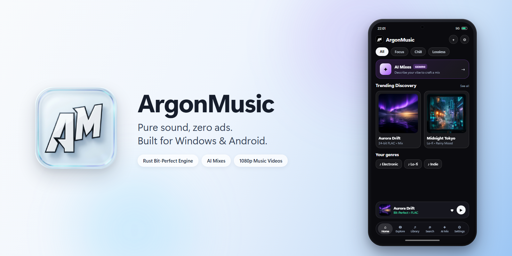
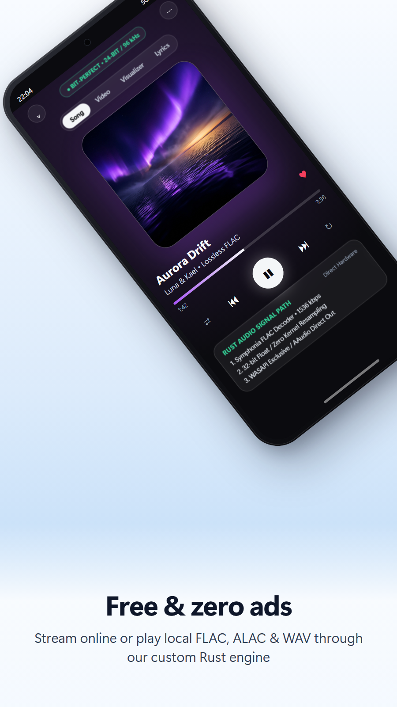
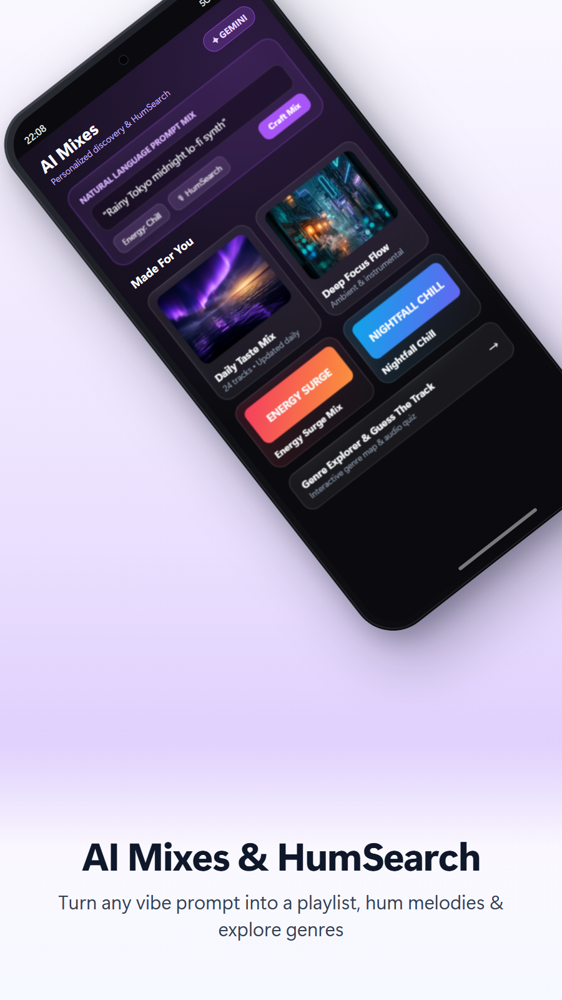
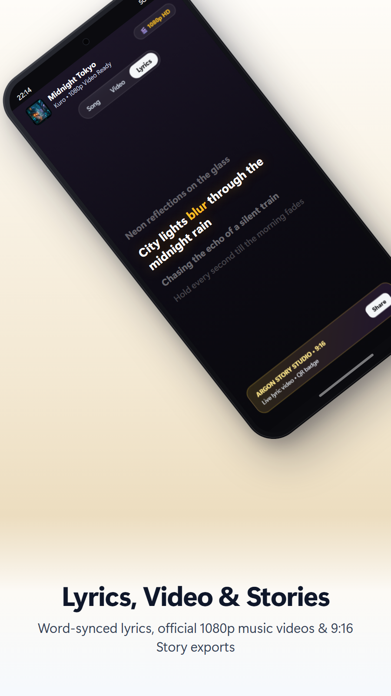
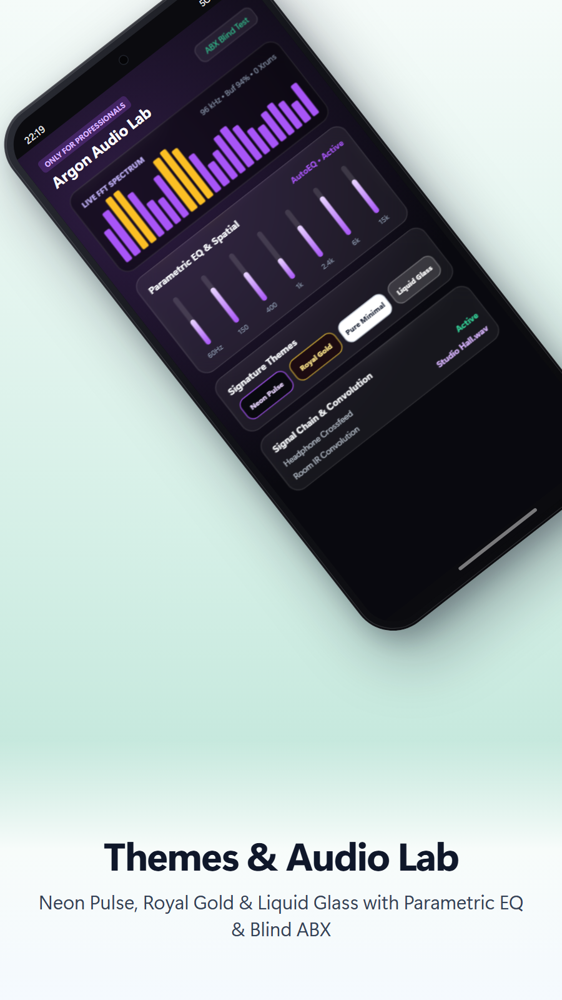

 

# ArgonMusic

**A fast, distraction-free, ad-free music player for Windows & Android — powered by a custom Rust audio engine.**

[About](#about-argonmusic) •
[Screenshots](#screenshots) •
[Features](#key-features) •
[Downloads](#downloads--installation) •
[Support](#support--links)

---

## About ArgonMusic

**ArgonMusic** is built for people who care deeply about how their music **sounds**, **looks**, and **feels**. Instead of wrapping a heavy web player in ads and trackers, ArgonMusic pairs a responsive **Flutter** interface with an in-process **native Rust audio DSP engine** (`Symphonia` + `Rubato` + `WASAPI Exclusive` / `AAudio`).

Whether you are streaming online, syncing your self-hosted **Subsonic / Navidrome** server, or listening to local **24-bit FLAC / ALAC / WAV** libraries, ArgonMusic connects directly from your device with **zero middleman servers, zero ads, and zero telemetry**.

| Pillar | What It Means for You |
| :--- | :--- |
| **Pure Sound First** | Native Rust pipeline with Bit-Perfect WASAPI Exclusive / AAudio output, 32-bit float DSP, and live Signal Path inspection |
| **Zero Ads, Zero Tracking** | 100% free with no ads, no analytics telemetry, and on-device listening history |
| **Stream + Local + Offline** | Online catalog streaming, local lossless playback, Subsonic/Navidrome support, and offline downloads with embedded art & tags |
| **Windows & Android Native** | Tailored desktop split-screen & floating desktop widgets on Windows; foreground media session, Car Mode & home widgets on Android |
| **Verified Releases** | Every update manifest is cryptographically signed with **Ed25519** and verified with **SHA-256** checksums |

---

## Screenshots

  
  
  
  

---

## Key Features

### Audiophile Rust Audio Engine
- **Bit-Perfect Hardware Output**: Bypasses OS kernel mixers via **WASAPI Exclusive** (Windows) and **AAudio** low-latency paths (Android), verified in real time by the **Audio Signal Path** inspector.
- **32-Bit Float & TPDF Dither**: IEEE 754 floating-point internal DSP with optional 16-bit TPDF triangular dither and **Rubato** 256-tap sinc resampling.
- **Parametric EQ & AutoEQ**: 7-band parametric biquad equalizer (`60 Hz` – `15 kHz`) with genre presets, AutoEQ headphone profiles, and automatic bypass when Bit-Perfect mode is enabled.
- **3D Spatial Audio**: Binaural crossfeed delay network, room reflection modeling, and headphone virtualizer.
- **Gapless, Crossfade & Normalization**: Sample-accurate gapless playback, album-aware crossfade (0–12s), skip silence, and **EBU R128** loudness normalization.
- **Argon Audio Lab** *(Only for Professionals)*: Signal-chain node editor, live FFT spectrum & buffer/Xrun telemetry, custom WAV room convolution IR loader, blind **ABX** testing, and shareable JSON presets.

### Stream, Offline & Local Lossless
- **Multi-Source Playback**: Play local lossless files (`FLAC`, `ALAC`, `WAV`, `DSD`, `Opus`, `MP3`), connect **Subsonic / Navidrome** servers, or stream online directly.
- **Offline Downloads**: Download tracks with embedded cover art and metadata tags, smart cache limits, and Wi-Fi-only safeguards.
- **Playlist Import & Splitter**: Import playlists from links, CSV, or JSON with fuzzy track matching, and split oversized playlists by artist, genre, duration, or track count.

### AI Mixes, AI DJ & Smart Discovery
- **Personalized AI Mixes**: Distinct curated mixes (*Daily Taste Mix*, *Deep Focus Flow*, *Energy Surge Mix*, *Nightfall Chill*, *Time-of-Day*, and *Sleep Wind-Down*) plus **Natural Language Prompt Mixes** powered by **Google Gemini** (e.g., *"Rainy Tokyo midnight lo-fi"*).
- **AI DJ Session**: Interactive mood-based DJ companion with spoken track transitions across 7 vibes.
- **HumSearch**: Hum or whistle a melody into your microphone to match songs in your library.
- **Explore, Genre Explorer & Guess The Track**: Trace interactive genre-to-artist maps, test your ears in the **Guess The Track** audio quiz, and rediscover **Forgotten Gems**.

### Music Videos, Synced Lyrics & Creative Sharing
- **Official 1080p / 720p Music Videos**: Switch seamlessly between Song, Video, Visualizer, and Lyrics inside Now Playing with micro-synced audio handoff.
- **Millisecond Word-Synced Lyrics**: Karaoke-style word and line highlighting powered by **TTML**, **LRCLIB**, and embedded ID3 tags.
- **HoloDeck 3D, Live Covers & Pixel Shift**: Gyroscope-tilted 3D artwork with spring physics, looping **Live Animated Cover Arts**, and tile-shattering **Pixel Shift** transitions.
- **Argon Story Studio & QR Connect**: Export 9:16 animated lyric-video stories (`.mp4`) with mood tags and QR badges directly to Instagram Stories, or beam tracks and playlists across devices with **Argon QR Connect**.

### Signature Themes & Personal Space
- **Themes Built for Every Mood**: **Neon Pulse** (`#09090F` + `#A855F7`), **Royal Gold** (burgundy + `#D4AF37`), **Pure Minimal** (crisp high-contrast), **Liquid Glass**, **Cinematic Focus Mode**, **Cover Studio**, and **Battery Saver Mode**.
- **Personal Music Space**: **Argon Identity**, **Music Diary** (attach personal notes to songs), **Monthly Music Story**, **Album Relationship Scores**, and **Argon Achievements**.

### Native Windows & Android Extras
- **Windows Desktop Widgets**: Floating borderless overlays for animated 3-line synced lyrics, rotating vinyl + 360° radial visualizer, and orbital Now Playing hub.
- **Discord Rich Presence**: Live listening status on **both Windows & Android** with Incognito toggle.
- **Android Widgets, Car Mode & Sleep Timer**: Home screen playback widgets, oversized **Car Mode** controls, headset double-tap play/pause support, and **Gentle Fade** sleep timer.

---

## Downloads & Installation

All official Windows and Android builds are published on the [**Releases page**](https://github.com/Divyaansh22312/ArgonMusic-releases/releases/latest):

| Platform | Package | Notes |
| :--- | :--- | :--- |
| **Windows 10 / 11 (x64)** | `ArgonMusic-Setup-x64-v*.exe` | Recommended Inno Setup installer |
| **Windows 10 / 11 (x64)** | `ArgonMusic-v*-Windows-x64-Portable.zip` | Extract & run anywhere, no installation needed |
| **Android (API 26–36)** | `ArgonMusic-v*-arm64-v8a.apk` | Recommended for modern 64-bit Android phones |
| **Android (API 26–36)** | `ArgonMusic-v*-universal.apk` | Universal APK compatible with all Android ABIs |
| **Android (Other ABIs)** | `armeabi-v7a.apk` / `x86_64.apk` | Legacy 32-bit ARM and emulator/x86_64 builds |

### Security & Integrity
- Release manifests (`update.json`) are cryptographically signed with **Ed25519**.
- All binaries are published with **SHA-256** verification hashes (`SHA256SUMS`).

---

## Support & Links

- **Website**: [argonmusic.vercel.app](https://argonmusic.vercel.app)
- **Latest Releases**: [GitHub Releases](https://github.com/Divyaansh22312/ArgonMusic-releases/releases)
- **Changelog**: [CHANGELOG.md](CHANGELOG.md)
- **Support Development**: Scan or open [donate_upi.jpeg](Donate_UPI.jpeg) to support ArgonMusic development.
